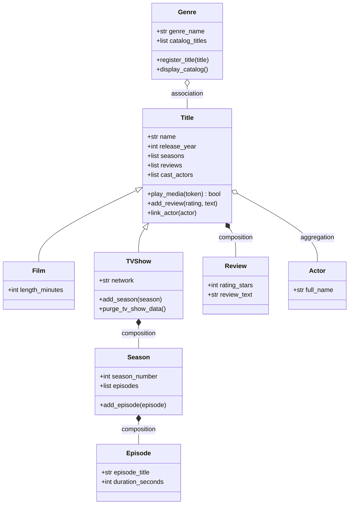

# Lab 10 & Lab 11 Report

**Course:** GEIAL314-B2a — Software Technology Practical Lab
**Student:** XUHAOJIE
**Neptun code:** DTR5N0
**Project:** Streamy Video Streaming Backend Platform
**Repository:** https://github.com/2923565578/Game-Introduction-Platform
**Date:** 2026-11-27

---

## 1. Objective

This report covers two connected labs. Lab 10 turns a UML class diagram into Python code. Lab 11 fills that code with real logic and tests it at runtime.

**Lab 10 goals:**
1. Read a UML class diagram and map it to Python classes.
2. Write a skeleton file `streamy_core.py` with empty `pass` method bodies.
3. Check that the skeleton compiles with no syntax error.
4. Use Git: create a branch, commit, open a pull request, merge.

**Lab 11 goals:**
1. Replace every `pass` stub with real business logic.
2. Enforce the two UML lifetime rules in code: composition and aggregation.
3. Build the playback authorization flow taken from the sequence diagram.
4. Write an integration test block and run it in the terminal.
5. Complete the delivery sprint: final pull request and Kanban board.

---

## 2. Theoretical Background

A UML class diagram is a plan. Python code is the building. Each UML element has one Python form:

| UML element | Python form |
|---|---|
| Class | `class Name:` |
| Attribute | instance variable inside `__init__` |
| Method | function inside the class |
| Generalization (inheritance) | `class Child(Parent):` |
| Composition `*--` | parent owns the child list; parent delete clears children |
| Aggregation `o--` | parent holds a reference only; the child object lives on |
| Association | one class keeps a list of references to another class |

The key difference between composition and aggregation is **who owns the object life**. In a TV platform:

- A **Season** and an **Episode** cannot exist without their **TVShow**. If the show is removed, the seasons and episodes must be removed too. This is composition, and the code must delete them in a loop.
- An **Actor** exists on its own. The same actor can act in many titles. If one show is removed, the actor record must stay. This is aggregation.

A skeleton file with `pass` bodies is a safe first step. The file compiles, the structure is visible, and no logic can be wrong yet. This matches normal practice: build the frame, then fill it.

The Git branch workflow keeps work away from `main`. A pull request is the review gate before merge. A commit message with the `feat:` prefix follows the conventional commit style used in this course.

---

## 3. Implementation

### 3.1 Class skeleton (Lab 10)

File: `streamy_core.py`. Eight domain classes were created:

1. `Title` — abstract parent of all media. Holds `name`, `release_year`, and the three lists `seasons`, `reviews`, `cast_actors`. Methods: `play_media()`, `add_review()`, `link_actor()`.
2. `Film(Title)` — adds `length_minutes`. Inherits all title behaviour.
3. `TVShow(Title)` — adds `network`. Methods: `add_season()`, `purge_tv_show_data()`.
4. `Season` — holds `season_number` and the `episodes` list. Method: `add_episode()`.
5. `Episode` — holds `episode_title` and `duration_seconds`.
6. `Review` — holds `rating_stars` and `review_text`.
7. `Actor` — holds `full_name`. Stands alone, no parent owner.
8. `Genre` — holds `genre_name` and `catalog_titles`. Methods: `register_title()`, `display_catalog()`.

Two inheritance links were written: `Film` and `TVShow` both extend `Title`. In the constructor of each child, `super().__init__(name, release_year)` runs first, so the shared fields exist before the child adds its own.

Composition is shown by putting the child lists inside the parent constructor. Aggregation uses the same list pattern but with no delete rule — the list only holds references.

Compilation check:

```bash
python -m py_compile streamy_core.py
```

Result: exit code 0, no syntax error, no output. The skeleton is valid.

Git part of Lab 10:

```bash
git checkout -b feature/streamy-codebase
git add streamy_core.py
git commit -m "feat: add UML class skeleton for Streamy backend"
git push -u origin feature/streamy-codebase
```

Then a pull request was opened and merged into `main`. The feature branch was deleted after the merge.

### 3.2 Production logic (Lab 11)

Every stub was replaced. The logic of each method:

**`play_media(access_token)`** — the authorization flow from the sequence diagram, printed step by step:

1. The app engine receives the playback request.
2. The auth service checks the token.
3. If the token is `"EXPIRED_TOKEN"` or empty, return `False` and log `401 Unauthorized`.
4. Otherwise the token is valid: query the catalog, fetch the encryption descriptor, return `True` with the HLS stream endpoint.

The method returns a `bool`, so the test block can compare the result with the expected value.

**`add_review(rating, text)`** — creates a `Review` object and appends it to the title's own `reviews` list. The review has no life outside its title, so this is composition.

**`link_actor(actor)`** — appends an existing `Actor` object to `cast_actors`. The actor object is passed in from outside, so the title never creates or destroys it. This is aggregation.

**`add_season(season)` / `add_episode(episode)`** — build the composition tree `TVShow → Season → Episode`.

**`purge_tv_show_data()`** — the composition enforcement method. It loops over the seasons, clears every `episodes` list inside each season, then clears the `seasons` list itself. After that it clears `reviews`. It prints the number of cleared seasons and the number of actors still in the cast list. The actor count is the aggregation proof: the number stays the same before and after the purge.

**`register_title(title)`** — adds a title reference to a genre list.

**`display_catalog()`** — prints the genre name and every registered title with its year.

### 3.3 Integration test block (Lab 11)

The test lives under `if __name__ == "__main__":`, so it runs only when the file is executed directly, not when it is imported by `app.py`.

Test steps:

1. Create two independent actors: `Ashley Peacock`, `Eddy Gerbil`.
2. Create the genre `Sci-Fi`.
3. Create `TVShow("Stranger Things", 2016, "Netflix")`, `Season(1)`, `Episode("Chapter One: The Vanishing of Will Byers", 2880)`.
4. Wire composition: episode into season, season into show.
5. Wire aggregation and association: two actors linked to the show, the show registered to the genre.
6. Run the unhappy path with `"EXPIRED_TOKEN"`, expect `False`.
7. Run the happy path with `"VALID_STREAM_TOKEN_2026"`, expect `True`.
8. Print the catalog.
9. Call `purge_tv_show_data()` and read the memory-management log.

### 3.4 Git delivery (Lab 11)

```bash
git checkout -b feature/system-delivery
git add streamy_core.py
git commit -m "feat: complete stream validation methods and cascade delete logic verification"
git push -u origin feature/system-delivery
```

Pull request title: *Delivery: Finalize Functional Code and Verify System Architecture*. The checklist in the PR body marked the four validated items: playback rules, composition purge, runtime simulation, documentation. The branch was merged and deleted, local `main` was pulled, and the sprint issue was moved to Done.

---

## 4. Test Results

### 4.1 Compilation test

`python -m py_compile streamy_core.py` — passed. No error line, no warning.

### 4.2 Runtime integration test

Command:

```bash
python streamy_core.py
```

Actual terminal output:

```
=== STREAMY BACKEND ARCHITECTURAL VERIFICATION RUNTIME ===

[App Engine] 1. Processing playback route request for: 'Stranger Things'
[Auth Service] 2. Checking authorization token state: 'EXPIRED_TOKEN'
[Auth Service] 3a. Token verification failed: Return 401 Unauthorized payload.
Scenario Verification Result: False (Expected: False)

[App Engine] 1. Processing playback route request for: 'Stranger Things'
[Auth Service] 2. Checking authorization token state: 'VALID_STREAM_TOKEN_2026'
[Auth Service] 3b. Token authorized. Querying Media Catalog Engine.
[Catalog Engine] 4. Fetching content encryption descriptors for: 'Stranger Things'
[Catalog Engine] 5. Handshake OK: Return 200 OK + HLS Stream URL endpoint.
Scenario Verification Result: True (Expected: True)

[Taxonomy Index] Titles registered under Genre Category: 'Sci-Fi'
 - Stranger Things (2016)

[Memory Management] Triggering cascading deletion for TV Show: 'Stranger Things'
[Memory Management] Cascading delete complete: 1 Season arrays cleared.
[Memory Management] Aggregation check: Cast ledger contains 2 actors (Left Intact).
```

### 4.3 Result analysis

| Check | Expected | Actual | Status |
|---|---|---|---|
| Skeleton compiles | no syntax error | no error | pass |
| Expired token returns False | `False` | `False` | pass |
| Valid token returns True | `True` | `True` | pass |
| Auth log shows steps 1 to 5 | 5 steps printed | 5 steps printed | pass |
| Genre catalog shows registered title | `Stranger Things (2016)` | same | pass |
| Composition: seasons cleared on purge | 1 season cleared | 1 season cleared | pass |
| Aggregation: actors survive purge | 2 actors intact | 2 actors intact | pass |

Both lifetime rules are enforced by executable code, not by comments. The purge log shows `1 Season arrays cleared` (composition) and `2 actors (Left Intact)` (aggregation). This is the direct evidence Lab 11 asks for.

---

## 5. Bonus Work

Extra work was added beyond the base requirement, in three layers: the interface, the
upload/streaming pipeline, and the documentation.

### 5.1 Web front end — full video platform

Files: `app.py`, `templates/index.html`, `static/css/app.css`, `static/js/app.js`.

The bonus layer is a complete browser interface for the platform, not a test page:

- **Header:** logo, view tabs (Home / Films / TV Shows / With video), live search over titles, genres and actors, upload button and user chip.
- **Featured hero:** the backdrop of the current title, type badge, year, seasons or runtime, cast, synopsis, and two actions (play, architecture demo).
- **Platform ledger:** live counters for titles, titles with a video file, aggregated actors and storage used, read from `/api/stats`.
- **Catalogue grid:** 2:3 poster cards. A real poster image is used when one was uploaded; otherwise the card draws a gradient generated from a hash of the title plus the first letter, so every card looks intentional without fake artwork.
- **Filtering:** nav view, genre chips and search combine, and the list re-sorts by creation time.

The page is rendered entirely from JSON; nothing is hard-coded in the HTML except the shell.

Run:

```bash
pip install flask
python app.py
```

Open `http://127.0.0.1:5000`.

Important note: `app.py` does not duplicate any business logic. The authorization rule still lives only in `Title.play_media()`. The web layer is a thin adapter.

### 5.2 Upload and streaming pipeline

Upload is a real file transfer, not a mock:

1. The browser posts `multipart/form-data` to `POST /api/upload`: the video, an optional poster image, and the metadata fields (title, year, kind, genre, actors, minutes or seasons, network, synopsis).
2. `app.py` validates the extension against `mp4 / webm / ogv / mov / m4v / mkv`, stores the file under `uploads/` with a UUID name, rejects anything over 4 GB, and appends a record to `data/media.json`.
3. The domain object for that record is rebuilt immediately (`build_title`), so the new title can be played at once, not after a restart.
4. Upload progress is driven by `XMLHttpRequest.upload.onprogress`, so the bar reflects bytes on the wire, not a fake timer.

Streaming uses HTTP range requests:

- `GET /media/<file>` serves the file with `conditional=True`, so the response is `206 Partial Content`.
- Because of that the player can seek; a plain full-file response would force a download from byte zero every time.

The token gate in the player is wired to the domain logic:

- Clicking *Authorize* calls `POST /api/play/<id>` with the token.
- The server captures the `print()` output of `Title.play_media()` with `contextlib.redirect_stdout` and returns it with the decision.
- The five authorization lines therefore appear under the player as they were written in the lab, not as re-typed UI text.
- Any non-empty token returns `True` and a stream URL; an empty token or the literal `EXPIRED_TOKEN` returns `401 Unauthorized`, exactly the rule from the lab.

### 5.3 Source repair and documentation

The code printed in the lab PDF was broken by page wrapping: methods were cut across lines, the `def __init__` lines were wrong, and one `clear()` method was misplaced. The delivered `streamy_core.py` is the repaired version, and `python -m py_compile` proves it is valid.

`README.md` gives the file list and the run commands. `Bonus.md` lists each extra feature with its file name, as the instructor requested.

---

## 6. Conclusion

The full life cycle was completed for this assignment: UML model, skeleton code, functional logic, runtime verification, Git delivery.

Three technical points were proven by execution rather than by description:

1. **Inheritance works.** `Film` and `TVShow` both build on `Title` and share its methods, with `super().__init__()` chaining the constructors.
2. **Composition works.** Purging a `TVShow` clears its `Season` and `Episode` objects in a cascade loop, because those objects have no life of their own.
3. **Aggregation works.** `Actor` objects survive the purge unchanged, because the show only holds references to them.

The playback flow returns the correct boolean for both paths, and the printed log matches the five steps of the sequence diagram.

Working with Git branches and pull requests showed the delivery side of engineering: code is written on a feature branch, reviewed, merged, and then the branch is removed. The bonus layer showed that a full interface, a file pipeline and an upload form can be added on top of unchanged domain code: `play_media()` was never rewritten for the web, which is the practical meaning of separation between business logic and presentation.

Limitation: the catalogue is a JSON file and the token check is a two-branch condition. There is no database, no real token service and no user account, so this work verifies architecture, logic and delivery, not production security or durability.

---

## Appendix A — File list

| File | Purpose |
|---|---|
| `streamy_core.py` | domain classes, production logic, integration test |
| `app.py` | Flask adapter: catalogue, upload, streaming, token gate, purge demo |
| `templates/index.html` | page shell |
| `static/css/app.css` | dark cinema theme |
| `static/js/app.js` | rendering, upload progress, player and token gate |
| `data/media.json` | catalogue, created on first start |
| `uploads/` | uploaded videos and posters; only `demo_stream.mp4` ships with the repo |
| `Report.md` | this report |
| `Lab10-11_Report_XUHAOJIE_DTR5N0.docx` | the same report as a Word document |
| `Bonus.md` | bonus feature document for the instructor |
| `README.md` | repository front page and run guide |
| `.gitignore` | excludes `__pycache__`, `uploads/` and `data/` |

## Appendix B — How to run

```bash
# 1. syntax check
python -m py_compile streamy_core.py

# 2. core integration test (Lab 10 + Lab 11 evidence)
python streamy_core.py

# 3. optional bonus web UI
pip install flask
python app.py
```

Environment: Python 3.8 or newer. The core test needs nothing else; the web layer needs `flask`.

On a fresh clone, `data/media.json` does not exist yet. The first start seeds two demo
titles and attaches the bundled `uploads/demo_stream.mp4`, so the player works before
anything is uploaded.

## Appendix C — UML class diagram


